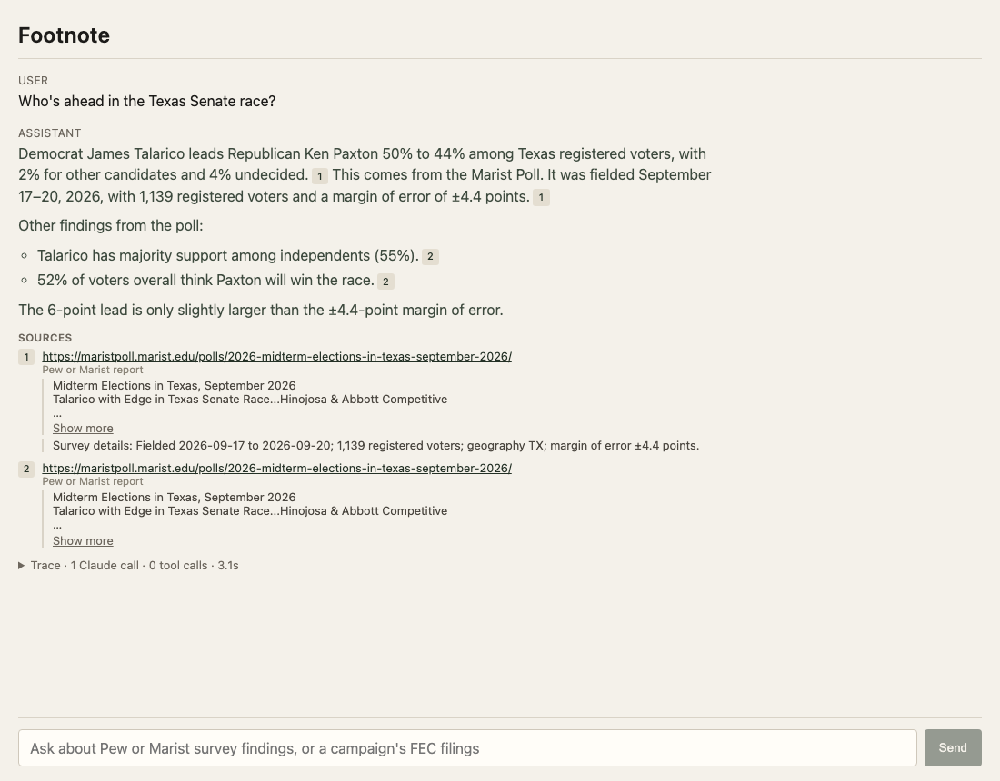

# Footnote

[](https://github.com/ianlhenry/papertrail/actions/workflows/check.yml)

Footnote is a research assistant for polling and campaign finance data. You ask a question in plain language, and it searches poll write-ups and queries FEC records to answer it. Every claim links back to the exact passage or query result it came from, so you can check it before acting on it. When the data doesn't cover the question, it refuses and tells you what's missing.

## Results

Three graded runs of the 10 verified cases, three repetitions each (30 answers). Adding FEC tools moved facts from 79% to 98%. The decline tool moved refusal from 80% to 100%. The full series is in [evals/results.md](evals/results.md).

| change | facts | refusal |
| --- | --- | --- |
| Poll passages retrieved | 79% | 80% |
| FEC tools added | 98% | 80% |
| Decline tool added | 98% | 100% |



## Run

Requires Node.js 22.18 or newer.

Copy [`.env.example`](.env.example) to `.env` and fill in the API keys. The database is not in the repo; build it with the ingest steps in [scripts/README.md](scripts/README.md).

```sh
npm install
npm install --prefix web
npm run dev
```

Open http://127.0.0.1:5173.

## Check

`npm run check` runs the formatter, the linter, both typechecks, the unit tests, and the eval tests. A commit runs it before it is created, and GitHub Actions runs it on every push.

## Docs

- [Architecture](docs/architecture.md)
- [Evals](docs/evals.md)
- [Backend](server/README.md)
- [Frontend](web/README.md)
- [Scripts](scripts/README.md)
