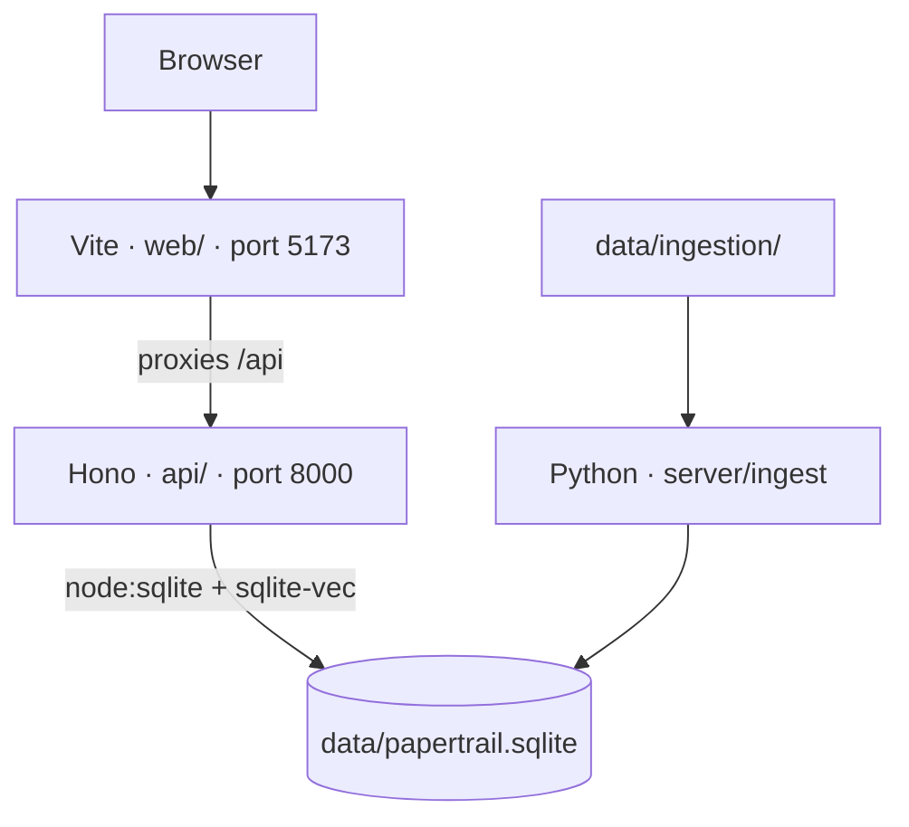

# Architecture

Three parts share one SQLite file, `data/papertrail.sqlite`. Override the path with `DATABASE_PATH`.

The page is served by Vite, so the browser's origin is port 5173. The chat API is a different process. The proxy makes `/api/chat` a same-origin request. Calling port 8000 from the page directly would be cross-origin.

`npm run dev` starts Vite and the API together. Ingestion is a separate batch run. It reads the files under `data/ingestion/` and replaces its tables in the database. `data/` is gitignored.

FEC tables loaded today: `fec_candidate`, `fec_committee`, `fec_candidate_committee`, `fec_candidate_summary`, `fec_pac_summary`, and `fec_independent_expenditure`. Marist and Pew have no tables yet. The API opens the database and loads `sqlite-vec` on startup. It does not query those tables yet.
