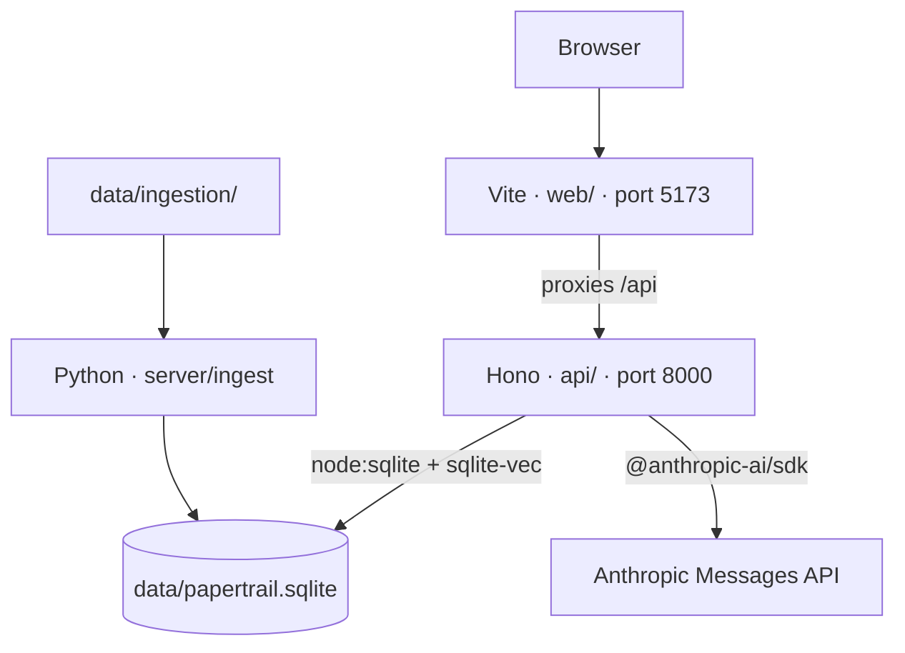

# Architecture

Three parts share one SQLite file, `data/papertrail.sqlite`. Override the path with `DATABASE_PATH`.

The page is served by Vite, so the browser's origin is port 5173. The chat API is a different process. The proxy makes `/api/chat` a same-origin request. Calling port 8000 from the page directly would be cross-origin.

The API answers each chat message with one Claude call from `api/agent.ts`, which is where the agent loop will grow. It does not send history or use tools yet.

`npm run dev` starts Vite and the API together. Ingestion is a separate batch run. It reads `data/ingestion/` and writes the database. `data/` is gitignored.

FEC tables loaded today: `fec_candidate`, `fec_committee`, `fec_candidate_committee`, `fec_candidate_summary`, `fec_pac_summary`, and `fec_independent_expenditure`. The FEC loader replaces those tables on each run.

Poll articles share `documents`, `passages`, `passage_embeddings`, `surveys`, and `document_surveys`. Pew and Marist write those through one loader, `server/ingest/articles.py`, which fetches and caches pages, chunks, embeds, and stores them. Each source module only turns its pages into text blocks and surveys. A page is embedded again only when its passages or the embedding model change, and pages that left the manifest are deleted. The API opens the database read-only with `sqlite-vec` loaded. For each question it embeds the question with Voyage `voyage-4`, the model the passages were embedded with, takes the 8 nearest passages, and gives them to Claude as citable search results. Claude can also call three FEC tools in `api/fec.ts`: `search_candidates`, `rank_candidates`, and `search_committees`. They read the FEC tables and return each record as a citable search result, with one text block per table row, so a citation names the exact record. The agent loop allows up to six Claude calls per question, and the last call has tools turned off so it has to answer.
