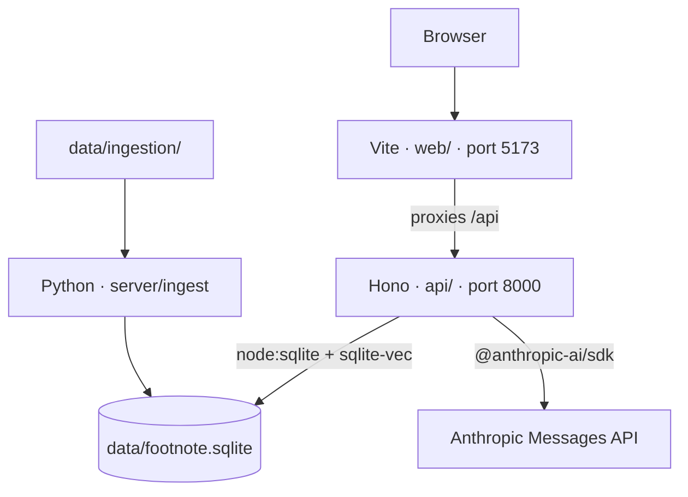

# Architecture

Three parts share one SQLite file, `data/footnote.sqlite`. Override the path with `DATABASE_PATH`.

The page is served by Vite, so the browser's origin is port 5173. The chat API is a different process. The proxy makes `/api/chat` a same-origin request. Calling port 8000 from the page directly would be cross-origin.

Each answer shows numbered citation markers that link to a source list below it, with the quoted text and a link to the article or FEC record. A badge marks answers the agent declined, with the reason. "Trace" expands to the passages retrieved, each FEC tool call and what it returned, and the Claude calls, tokens, and seconds the answer took. A spinner shows while the agent works.

`POST /api/chat` takes `{ "content": "..." }` and returns the user message plus Claude's reply. There is no conversation history yet. The reply also carries `status` (`answered` or `refused`), `citations`, `retrieved`, `tool_calls`, and `usage`, defined in `api/contract.ts`. The eval in `evals/` grades them. `retrieved` lists the passages given to Claude and `citations` the passages it cited. `tool_calls` lists each FEC tool call with its input and the records it returned. `usage` has one entry per Claude call, with its tokens and `cost_usd` at the list prices in `api/pricing.ts`. `decline_reason` is `not_loaded`, `out_of_scope`, or `opinion` when `status` is `refused`, and null otherwise. Without `ANTHROPIC_API_KEY` or `VOYAGE_API_KEY`, `/api/chat` returns 503. Errors from Anthropic or Voyage return 502.

Ingestion is a separate batch run. It reads `data/ingestion/` and writes the database. `data/` is gitignored.

FEC tables loaded today: `fec_candidate`, `fec_committee`, `fec_candidate_committee`, `fec_candidate_summary`, `fec_pac_summary`, and `fec_independent_expenditure`. The FEC loader replaces those tables on each run.

Pew and Marist reports share `documents`, `passages`, `passage_embeddings`, `surveys`, and `document_surveys`. Pew and Marist write those through one loader, `server/ingest/articles.py`, which fetches and caches pages, chunks, embeds, and stores them. Each source module only turns its pages into text blocks and surveys. A page is embedded again only when its passages or the embedding model change, and pages that left the manifest are deleted. The API opens the database read-only with `sqlite-vec` loaded. For each question it embeds the question with Voyage `voyage-4`, the model the passages were embedded with, takes the 8 nearest passages, and gives them to Claude as citable search results. Claude can also call three FEC tools in `api/fec.ts`: `search_candidates`, `rank_candidates`, and `search_committees`. They read the FEC tables and return each record as a citable search result, with one text block per table row, so a citation names the exact record. Claude can also call a `decline` tool when it can answer no part of the question. That ends the loop and marks the answer refused, with a reason. The agent loop allows up to six Claude calls per question, and the last call has tools turned off so it has to answer. Tools and the system prompt are cached: a breakpoint at the end of the system prompt lets calls within five minutes of each other, in one question's loop or across questions, read that prefix at a tenth of the input price. The retrieved passages vary per question and are not cached.
